# KAUDITAN SIAGA 2.0

## Sistem Informasi Pendeteksi dan Pencegahan Kebakaran Hutan di Perkebunan Raya Desa Kauditan II Berbasis Web

Sistem informasi berbasis web untuk Perkebunan Raya Desa Kauditan II yang membantu masyarakat/petani, perangkat desa (Kepala Jaga), dan petugas lapangan memantau titik panas (hotspot), mengetahui status risiko kebakaran (Aman, Waspada, Siaga, Awas), melapor, serta berkoordinasi agar kebakaran terdeteksi lebih dini dan lokasinya presisi.

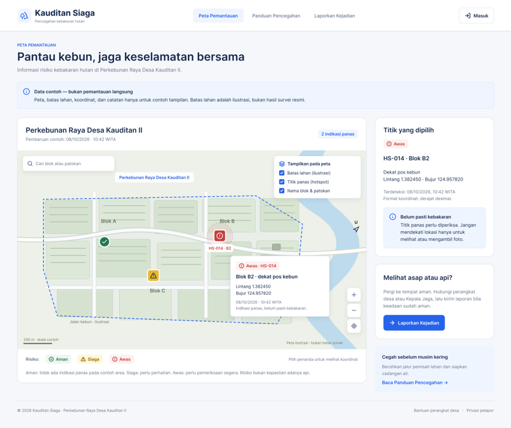

*Gambar 1 — Prototipe halaman utama: peta pemantauan dan status risiko (L-01)*

| | |
|---|---|
| **Mata kuliah** | System Analysis and Design — Fakultas Ilmu Komputer, Universitas Klabat |
| **Kelompok** | Korektor |
| **Studi kasus** | Perkebunan Raya Desa Kauditan II, Minahasa Utara |
| **Model SDLC** | Waterfall (P1–P6, 2–20 November 2026) |
| **Versi dokumen** | SRS versi 1.0 — 20 November 2026 |
| **Repository** | [https://github.com/gabiyell/Kauditan-Siaga-2.0](https://github.com/gabiyell/Kauditan-Siaga-2.0) |
| **Prototipe UI** | [Figma — UI-UX Kauditan Siaga versi beta 1.0](https://www.figma.com/proto/4iZq7M7G2g4CjL2WFVjUvg/UI-UX-Kauditan-siaga-versi-beta-1.0?node-id=0-1&t=RLLOmOddJhigZiRx-1) |

## Anggota Kelompok

| No | Nama | NIM | Peran | Kontribusi utama |
|----|------|-----|-------|------------------|
| 1 | Goni, Gabriel Richard | 105012510018 | Project Manager | Mengoordinasikan tim dan jadwal, mengelola repositori, menjaga alur kerja SDLC, draf SRS Bagian 1–2 |
| 2 | Rares, Josua Afriyan | 105022510105 | System Analyst | Elisitasi kebutuhan, penyusunan dokumen SRS, matriks keterlacakan, use case diagram dan description, activity diagram (Bagian 6) |
| 3 | Reo, Marchiando Stephen | 105022510086 | UI/UX Designer & System Designer | Prototipe antarmuka Figma, pemodelan UML (use case, activity, sequence, class diagram) |
| 4 | Sompie, Yehuda Miracle | 105022510032 | Database & Backend Specialist | ERD, kamus data, arsitektur basis data, API backend (Bagian 7–9) |
| 5 | Loing, Clifford Justine | 105012510113 | Lead Developer | Antarmuka front-end, integrasi logika bisnis, repositori kode, implementasi dan pengujian black-box (Bagian 10) |

## Latar Belakang

- **Masalah:** Deteksi kebakaran hutan/lahan terlambat dan lokasi kejadian sulit dipastikan secara presisi, sehingga api sering sudah membesar ketika diketahui. Petugas diharapkan tiba di lokasi kurang dari 15 menit, tetapi tidak ada notifikasi real-time.
- **Kondisi saat ini:** Pemantauan dilakukan lewat patroli langsung dan himbauan lisan. Pelaporan lewat telepon/WhatsApp tanpa koordinat presisi. Tidak ada basis data terpusat; riwayat kejadian hanya tersimpan di percakapan WhatsApp atau diingat secara lisan. Data satelit (NASA FIRMS) dan cuaca (BMKG) belum dimanfaatkan. Analisis *design-reality gap* (ITPOSMO) menunjukkan skor rata-rata 6,3 dari 10, dengan kesenjangan terbesar pada dimensi *Information* dan *Processes*.
- **Tujuan sistem:**
  1. Pemantauan titik panas (hotspot) berbasis web dengan peta dan koordinat presisi.
  2. Pengkategorian status risiko kawasan (Aman, Waspada, Siaga, Awas) otomatis dari data satelit dan cuaca.
  3. Notifikasi peringatan dini (*early warning*) yang cepat kepada perangkat desa dan petugas lapangan.
  4. Kemudahan koordinasi penanganan darurat: pelaporan warga, verifikasi, dan ekspor data ke instansi terkait.
  5. Panduan tindakan pencegahan mandiri bagi warga dan petani (sekat pemisah lahan, persiapan air).
- **Pengguna (aktor):** Pada pemodelan perilaku (SRS Bagian 6), aktor diringkas menjadi dua peran utama:
  - **Pengguna (Masyarakat / Petani):** warga dan pemilik lahan yang memantau peta spasial, melihat status risiko, membaca panduan mitigasi, serta mengirim laporan indikasi kebakaran beserta foto lokasi.
  - **Perangkat Desa (Kepala Jaga / Operator / Administrator):** pengelola sistem yang memantau peta, memverifikasi laporan warga, mengubah status bahaya kawasan (otomatis memicu notifikasi *early warning*), mengelola akun pengguna, dan mengekspor data rujukan.

Pihak pendukung operasional yang dirujuk pada kebutuhan dan keamanan (SRS Bagian 3.2 dan 5.6): **Hukum Tua** (menetapkan status bahaya dan menyetujui koordinasi), **Petugas Lapangan/Penjaga Kebun** (mengonfirmasi titik api), **Admin Sistem** (akun dan konfigurasi), serta instansi terkait **BPBD/Damkar** sebagai penerima data rujukan hasil ekspor (tidak login langsung). **Sistem penjadwal** mengambil data NASA FIRMS dan BMKG secara berkala.

## Fitur Utama

| No | Fitur | Aktor | Use case | Kebutuhan |
|----|-------|-------|----------|-----------|
| 1 | Login / Autentikasi (RBAC) | Pengguna, Perangkat Desa | UC-11 | FR-08 |
| 2 | Memantau peta spasial dan hotspot | Pengguna, Perangkat Desa | UC-01 | FR-01 |
| 3 | Melihat status risiko (indikator warna) | Pengguna, Perangkat Desa | UC-02 | FR-02 |
| 4 | Panduan mitigasi mandiri | Pengguna | UC-03 | FR-04 |
| 5 | Mengirim laporan kejadian dan melampirkan foto lokasi | Pengguna | UC-04, UC-10 | FR-05 |
| 6 | Verifikasi laporan warga | Perangkat Desa | UC-05 | FR-06 |
| 7 | Ubah status bahaya | Perangkat Desa | UC-06 | FR-02, FR-06 |
| 8 | Notifikasi early warning (pop-up/panel notifikasi web) | Sistem (dipicu UC-06) | UC-07 | FR-03 |
| 9 | Ekspor data rujukan (PDF/Excel) | Perangkat Desa | UC-08 | FR-07 |
| 10 | Kelola akun pengguna | Perangkat Desa (Administrator/Operator) | UC-09 | FR-08 |
| 11 | Membuat akun pengguna | Perangkat Desa | UC-12 | FR-08, FR-09 |

**Kebutuhan non-fungsional utama** (SRS Bagian 5.3):

- Dashboard peta tampil kurang dari 3 detik pada koneksi minimal 2 Mbps (NFR-01).
- Notifikasi peringatan dini muncul maksimal 5 detik setelah data hotspot baru atau perubahan status diterima (NFR-02).
- Seluruh komunikasi memakai HTTPS (TLS); password di-hash (Bcrypt/Argon2); terlindung dari SQL Injection, XSS, dan CSRF (NFR-03).
- Antarmuka responsif, berbahasa Indonesia, dengan indikator warna Hijau/Kuning/Oranye/Merah (NFR-04).
- Ketersediaan minimal 99,5% per bulan, backup basis data tiap 24 jam, melayani 100 pengguna bersamaan (NFR-05).

## Tampilan Antarmuka

Berikut tampilan antarmuka sesuai prototipe Figma (SRS Bagian 9). Seluruh data pada prototipe adalah data contoh, bukan pemantauan langsung.

**[L-02] Panduan Pencegahan Kebakaran (UC-03)**

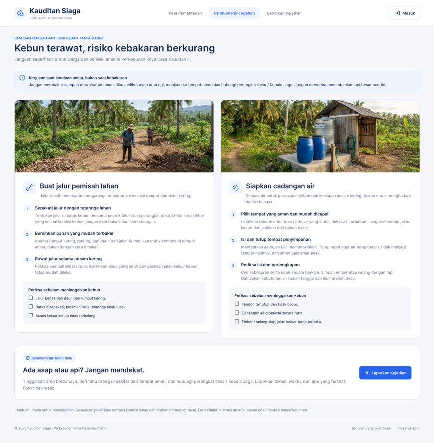

*Gambar 2 — L-02 Panduan Pencegahan Kebakaran (UC-03)*

**[L-03] Formulir Laporan Warga dan Unggah Foto (UC-04, UC-10)**

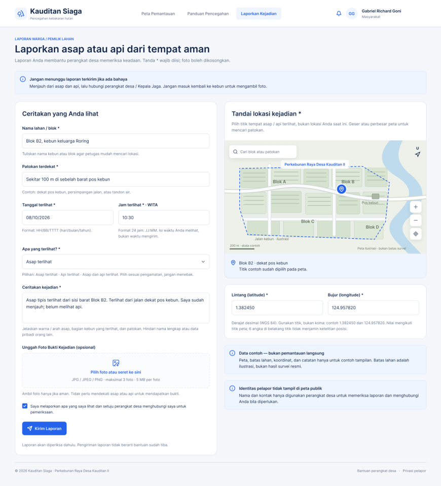

*Gambar 3 — L-03 Formulir Laporan Warga dan Unggah Foto (UC-04, UC-10)*

**[L-04] Ruang Operator: Peta Pemantauan dan Peringatan Dini (UC-01, UC-06, UC-07)**

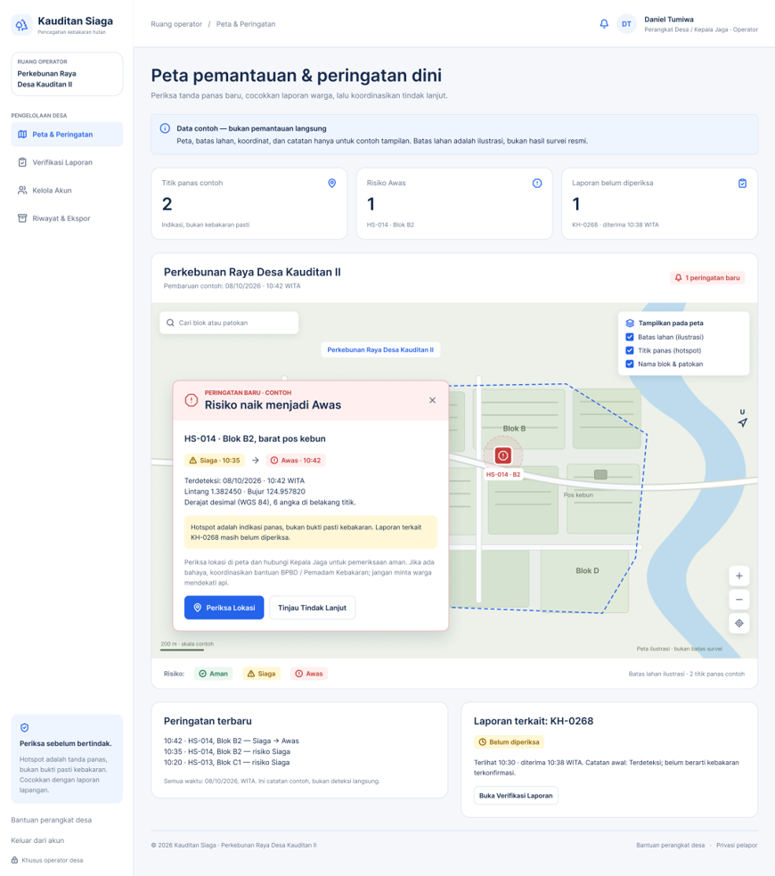

*Gambar 4 — L-04 Ruang Operator: Peta Pemantauan dan Peringatan Dini (UC-01, UC-06, UC-07)*

**[L-05] Ruang Operator: Verifikasi Laporan dan Status Penanganan (UC-05, UC-06)**

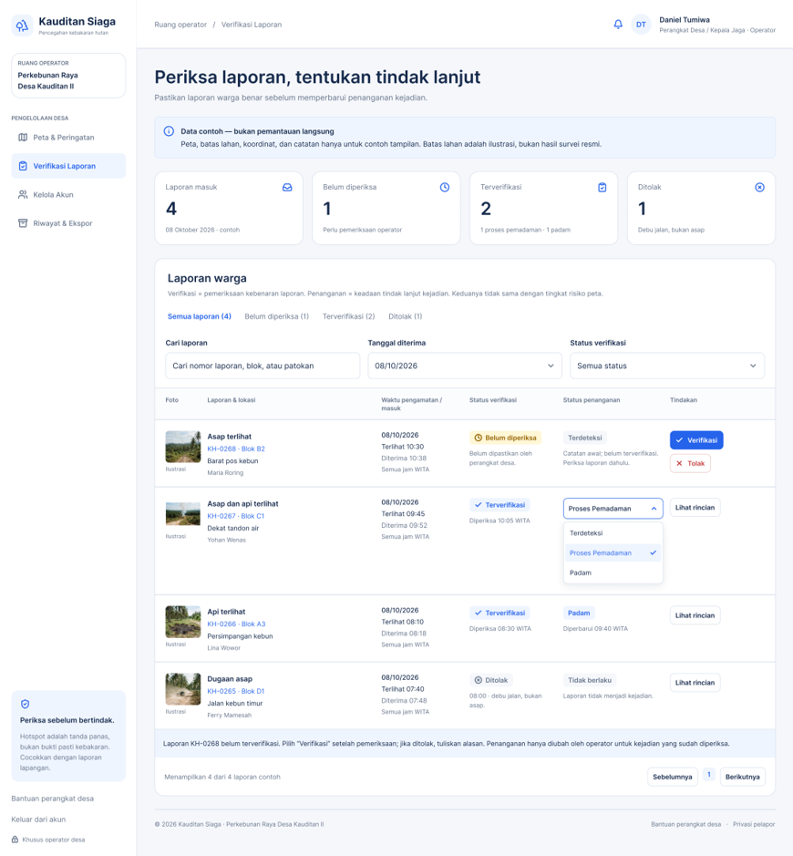

*Gambar 5 — L-05 Ruang Operator: Verifikasi Laporan dan Status Penanganan (UC-05, UC-06)*

**[L-06] Ruang Operator: Riwayat Kejadian dan Ekspor Laporan (UC-08)**

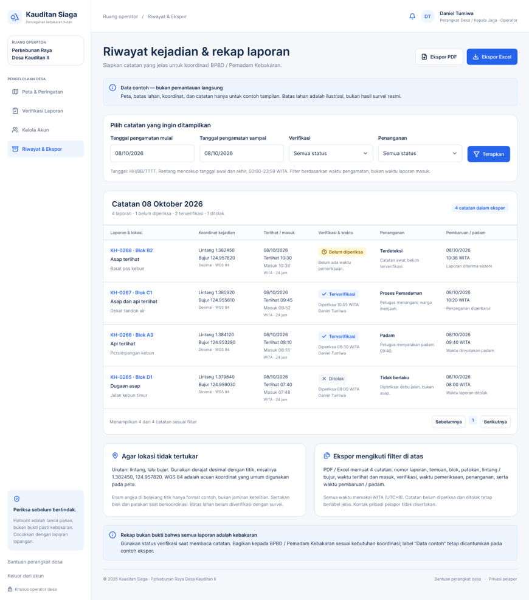

*Gambar 6 — L-06 Ruang Operator: Riwayat Kejadian dan Ekspor Laporan (UC-08)*

**[L-07] Ruang Operator: Kelola Akun Warga dan Perangkat Desa (UC-09)**

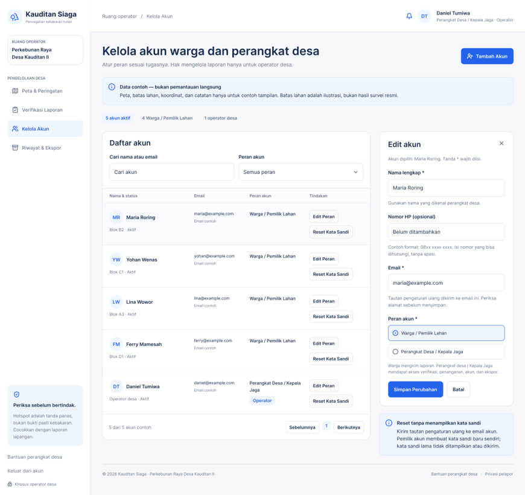

*Gambar 7 — L-07 Ruang Operator: Kelola Akun Warga dan Perangkat Desa (UC-09)*

**[L-08] Halaman Login dan Registrasi (UC-11)**

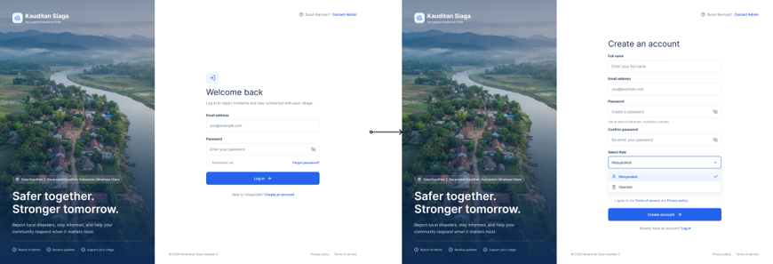

*Gambar 8 — L-08 Halaman Login dan Registrasi (UC-11)*

## Teknologi

| Lapisan | Teknologi | Keterangan |
|---------|-----------|------------|
| Front-end | React.js, Tailwind CSS, Leaflet.js / Mapbox GL | SPA responsif; peta interaktif dan marker hotspot |
| Back-end | Node.js (Express.js), REST API, arsitektur Microservices (Auth, Hotspot, Weather, Notification, Incident) | Event-driven, non-blocking I/O |
| Database | PostgreSQL + PostGIS, AWS S3 Bucket | Data spasial; penyimpanan foto bukti laporan |
| Hosting / lingkungan uji | Docker, Nginx (reverse proxy / API Gateway), Cloudflare CDN & Load Balancer | Konsistensi deployment, CDN, perlindungan DDoS |
| Layanan eksternal | NASA FIRMS API (MODIS/VIIRS), API cuaca BMKG, OpenStreetMap | Hotspot diambil tiap 1–3 jam, cuaca tiap 3–6 jam |
| Tools pemodelan | Visual Paradigm / Draw.io, Figma | UML, prototipe UI |
| Pengujian dan CI/CD | Postman, GitHub Actions | Pengujian API dan otomatisasi deployment |

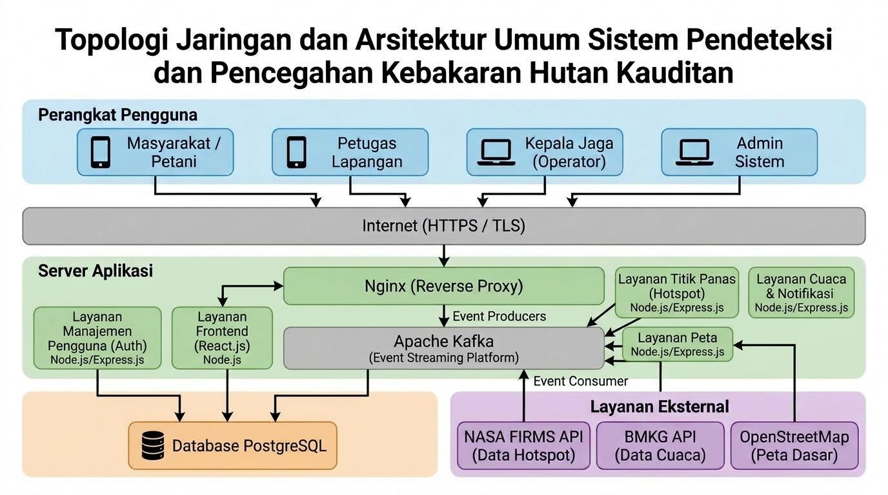

*Gambar 9 — Topologi jaringan dan arsitektur umum sistem*

## Kebutuhan Sistem

- Node.js dan npm
- PostgreSQL dengan ekstensi PostGIS
- Docker dan Nginx (untuk deployment)
- Git
- Browser modern (web responsif untuk ponsel, tablet, dan PC) dengan koneksi internet minimal 2 Mbps

## Instalasi dan Menjalankan Aplikasi

Repository: [https://github.com/gabiyell/Kauditan-Siaga-2.0](https://github.com/gabiyell/Kauditan-Siaga-2.0)

1. Clone repository:

   ```bash
   git clone https://github.com/gabiyell/Kauditan-Siaga-2.0.git
   cd Kauditan-Siaga-2.0
   ```

2. Pasang dependensi di folder `backend` dan `frontend` (masing-masing memiliki `package.json`):

   ```bash
   cd backend && npm install
   cd ../frontend && npm install
   ```

3. Siapkan konfigurasi. Salin file contoh `.env.example` di `backend` dan `frontend` menjadi `.env`, lalu isi koneksi database, API key NASA FIRMS, interval sinkronisasi, kredensial AWS S3, dan secret JWT:

   ```bash
   cp backend/.env.example backend/.env
   cp frontend/.env.example frontend/.env
   ```

4. Siapkan database PostgreSQL: buat database, aktifkan ekstensi PostGIS, lalu jalankan skrip pada `backend/migrations` dan data awal pada `backend/seeds`.

5. Jalankan aplikasi (sesuaikan dengan bagian `scripts` pada `package.json` masing-masing folder), lalu buka alamat yang tampil di terminal pada browser:

   ```bash
   cd backend && npm run dev
   cd frontend && npm run dev
   ```

### Akun uji

Akun uji untuk peran Masyarakat/Petani dan Perangkat Desa (Operator/Admin) dibuat melalui data awal pada folder `backend/seeds`. Lihat berkas seed tersebut untuk email dan password awal. Akun baru dibuat oleh Perangkat Desa melalui menu **Kelola Akun** (UC-09 dan UC-12), dengan password minimal 8 karakter.

## Struktur Folder

Struktur repository mengikuti arsitektur microservices (SRS 10.1) dan dipisah menjadi `backend`, `frontend`, `data`, dan `deploy`. Kelas entity, controller, dan service pada `backend/src` mengikuti class diagram (SRS 7.2) dan matriks keterlacakan (SRS 10.3).

```text
Kauditan-Siaga-2.0/
├── .github/workflows/     # CI/CD GitHub Actions
│   ├── ci.yml
│   ├── deploy-production.yml
│   └── deploy-prototype.yml
├── backend/               # Node.js, REST API
│   ├── migrations/        # skema basis data (SRS Bagian 8)
│   ├── seeds/             # data awal dan akun uji
│   ├── src/               # entity, controller, service
│   ├── test/              # pengujian backend
│   ├── .env.example
│   ├── package.json
│   └── tsconfig.json
├── data/
│   ├── boundaries/        # batas lahan (GeoJSON)
│   └── demo/              # data contoh
├── deploy/                # konfigurasi deployment
│   ├── aws/
│   ├── backend/
│   ├── release/
│   └── remote/
├── docs/                  # dokumentasi, diagram UML, dan tangkapan layar
│   ├── diagrams/
│   └── screenshots/
├── frontend/              # React.js + Tailwind CSS + Leaflet.js
│   ├── public/
│   ├── src/               # tampilan sesuai prototipe L-01 s.d. L-08
│   ├── tests/
│   ├── .env.example
│   ├── index.html
│   ├── package.json
│   ├── tailwind.config.js
│   └── vite.config.ts
├── .gitignore
├── .npmrc
├── eslint.config.mjs
├── package.json
└── README.md
```

## Rancangan Sistem

Ringkasan rancangan; detail lengkap ada di dokumen SRS.

| Artefak | Lokasi |
|---------|--------|
| Kebutuhan fungsional dan non-fungsional | SRS Bagian 5 (FR-01 s.d. FR-11, NFR-01 s.d. NFR-05) |
| Use case diagram dan description | SRS Bagian 6.2 dan 6.3 (UC-01 s.d. UC-12) |
| Activity diagram | SRS Bagian 6.4 |
| Sequence diagram | SRS Bagian 7.1 |
| Class diagram | SRS Bagian 7.2 |
| Model data (ERD) dan kamus data | SRS Bagian 8 (`users`, `hotspot`, `weather_logs`, `hazard_status`, `reports`, `mitigation_guides`, `notifications`) |
| Prototipe UI | [Figma (L-01 s.d. L-08)](https://www.figma.com/proto/4iZq7M7G2g4CjL2WFVjUvg/UI-UX-Kauditan-siaga-versi-beta-1.0?node-id=0-1&t=RLLOmOddJhigZiRx-1) |

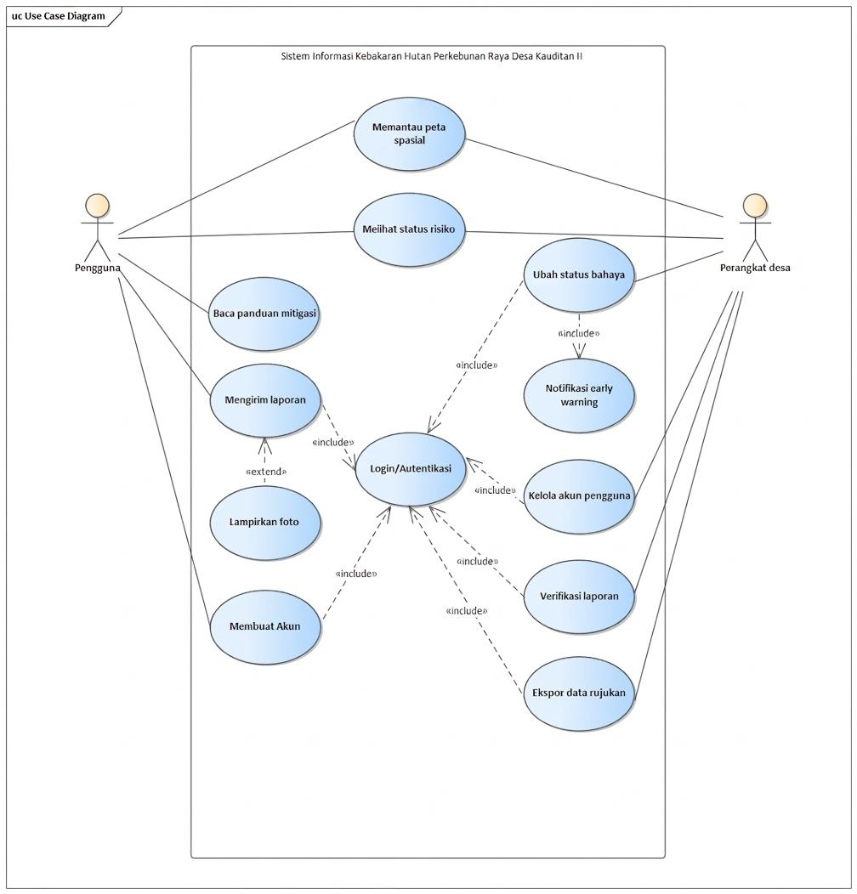

*Gambar 10 — Use case diagram (aktor Pengguna dan Perangkat Desa)*

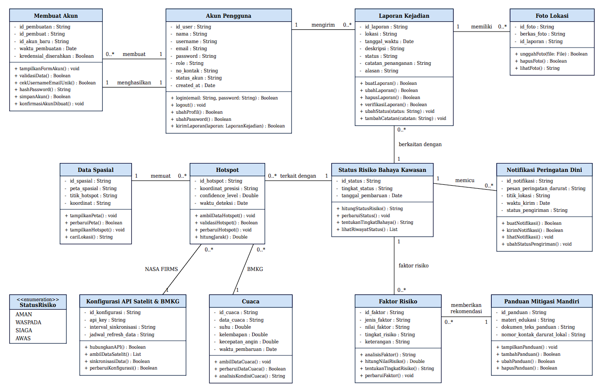

*Gambar 11 — Class diagram*

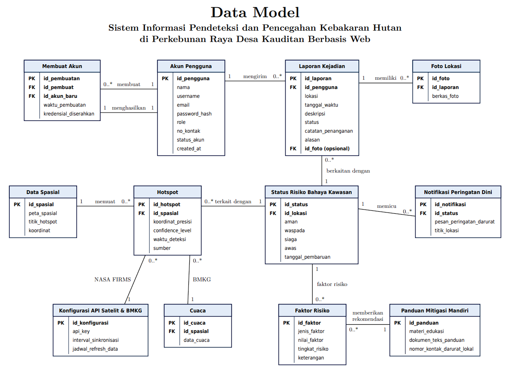

*Gambar 12 — Data model (ERD)*

## Pengujian

Ringkasan: **10 kasus uji black-box, 10 lulus**. Daftar lengkap ada di SRS 10.4.

| ID | Use case | Skenario | Hasil diharapkan | Status |
|----|----------|----------|------------------|--------|
| TC-01 | UC-11 | Login dengan data benar (email & password terdaftar) | Berhasil masuk ke dashboard utama | Lulus |
| TC-02 | UC-11 | Login dengan password salah (email benar, password salah) | Tampil pesan error "Password salah" | Lulus |
| TC-03 | UC-01 | Menampilkan peta spasial & titik hotspot (buka halaman dashboard peta) | Peta memuat batas kawasan & penanda hotspot | Lulus |
| TC-04 | UC-02 | Kalkulasi otomatis status risiko bahaya (data suhu & titik panas diperbarui) | Status kawasan berubah (Aman/Waspada/Siaga/Awas) | Lulus |
| TC-05 | UC-07 | Penerimaan notifikasi peringatan dini (pemicu status Awas terdeteksi) | Notifikasi alert terkirim real-time ke pengelola | Lulus |
| TC-06 | UC-03 | Akses modul panduan mitigasi mandiri (klik menu panduan mitigasi) | Tampil rekomendasi teknik sekat lahan/air | Lulus |
| TC-07 | UC-04, UC-10 | Pengiriman formulir laporan warga (input deskripsi, lokasi & foto bukti) | Laporan tersimpan & foto terunggah ke S3 | Lulus |
| TC-08 | UC-05 | Verifikasi laporan kejadian oleh Perangkat Desa (pilih laporan & ubah status ke "Proses") | Status insiden berhasil diperbarui di database | Lulus |
| TC-09 | UC-08 | Ekspor rekapitulasi data kejadian (klik tombol ekspor PDF/Excel) | File laporan terunduh sesuai format | Lulus |
| TC-10 | UC-11 | Pengujian hak akses / RBAC (akun Warga mencoba akses menu Verifikasi) | Akses ditolak & diarahkan kembali ke dashboard | Lulus |

**Bug yang ditemukan dan sudah diperbaiki:** keterlambatan notifikasi real-time saat sinyal lemah (diperbaiki dengan mengoptimalkan payload Webhook) dan format penulisan koordinat spasial pada layar peta.

## Keterbatasan dan Pengembangan Berikutnya

- Notifikasi WhatsApp/SMS Gateway berbayar tidak dipakai; notifikasi disimulasikan lewat pop-up/panel notifikasi di antarmuka web.
- Pengiriman laporan langsung ke sistem internal BPBD/Damkar tidak tersedia; hanya ekspor data PDF/Excel untuk dirujuk.
- Sistem hanya memakai data hotspot dari API pihak ketiga (NASA FIRMS); tidak memproses citra satelit mentah. Akurasi hotspot dibatasi resolusi dan jadwal lintasan satelit, serta ketersediaan API NASA FIRMS dan BMKG. Jika API tidak tersedia, sistem menampilkan data terakhir yang berhasil diambil beserta waktu pembaruannya.
- Tidak ada sensor IoT, perangkat pemantau fisik, atau otomatisasi alat pemadam di lapangan.
- Bukan aplikasi mobile native; sistem diakses lewat peramban web responsif.
- Status bahaya resmi hanya boleh ditetapkan oleh perangkat desa, dan sistem tidak menggantikan prosedur penanganan resmi.
- Operasional membutuhkan pelatihan singkat, SOP tertulis, serta penunjukan operator dan pemelihara sistem di desa setelah masa proyek berakhir.

## Penggunaan AI dan Referensi

| Alat AI | Dipakai untuk | Yang diperiksa atau diubah dari hasilnya |
|---------|---------------|------------------------------------------|
| Gemini AI | Diskusi analisis kebutuhan, pembentukan draf matriks keterlacakan, skenario kasus uji, dan tabel Arsitektur dan Teknologi (SRS Bagian 10.1, 10.3, 10.4 dan Lampiran A) | Memeriksa dan menyesuaikan kode FR (FR-01 s.d. FR-08) dan kode use case, serta menyelaraskan nama narasumber wawancara dengan isi SRS utama |
| ChatGPT / Claude | Menyusun draf kalimat perumusan masalah, merapikan tata bahasa Indonesia akademis, dan konsultasi struktur arsitektur Microservices (SRS Bagian 1 dan 10.1) | Mengubah istilah teknis agar sesuai konvensi IEEE Std 830-1998 dan memvalidasi kesesuaian komponen stack (Node.js, PostgreSQL/PostGIS, React.js, Docker) |
| GitHub Copilot | Membantu penulisan skrip penarikan data API (NASA FIRMS & BMKG) serta boilerplate kode React.js/Express.js (Service Hotspot dan Frontend Map View) | Memeriksa validasi tipe data koordinat spasial, menangani error handling jaringan, dan menyesuaikan struktur respons GeoJSON |

### Referensi

1. IEEE Std 830-1998, *IEEE Recommended Practice for Software Requirements Specifications*, IEEE Computer Society, 1998.
2. Badan Meteorologi, Klimatologi, dan Geofisika (BMKG). *Dokumentasi API Terbuka Data Cuaca Indonesia*.
3. National Aeronautics and Space Administration (NASA). *Fire Information for Resource Management System (FIRMS) API Documentation*.
4. Pressman, R. S., & Maxim, B. R. (2019). *Software Engineering: A Practitioner's Approach* (9th ed.). McGraw-Hill Education.
5. Pemerintah Desa Kauditan II. (2026). *Hasil Wawancara Pengumpulan Kebutuhan Sistem (Requirements Gathering) Pemantauan Kebakaran Perkebunan Raya Kauditan*. Minahasa Utara.
6. Leaflet API Reference. Open-Source JavaScript Library for Interactive Maps.